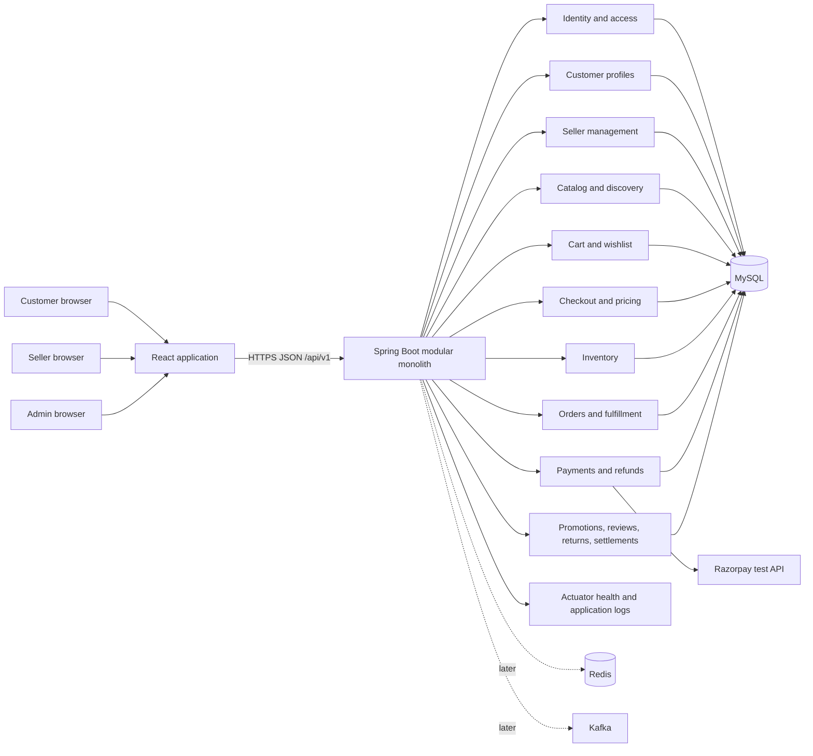

# MarketHub - Phase 2: Application Architecture

**Status:** Design baseline  
**Architecture:** Modular monolith with a separate React client  
**Related design:** [Phase 1 requirements and scope](phase-1-requirements-and-scope.md)

## 1. Architecture goals

- Make the marketplace one deployable backend at the start, with business modules that have clear ownership.
- Keep the browser responsible for presentation and interaction; keep pricing, permissions, inventory, orders, and payment verification on the server.
- Make seller and customer data boundaries explicit at API and service layers.
- Use database transactions for operations that must remain consistent inside MySQL.
- Isolate external services such as Razorpay behind module-owned interfaces.
- Add Redis, Kafka, and separately deployable services only after the core workflows justify them.

## 2. Context and container diagram



The current Vite app remains at the repository root. The Spring Boot application will live under `backend/`. Each is independently runnable in development; deployment may serve the built frontend and backend behind one public origin.

## 3. Backend module boundaries

| Module | Owns | May depend on |
|---|---|---|
| `identity` | User credentials, roles, token/session lifecycle | shared platform configuration |
| `customer` | Customer profile and address book | `identity` |
| `seller` | Seller application, store profile, seller status | `identity` |
| `catalog` | Categories, product descriptions, product media metadata | `seller` |
| `inventory` | Stock balances, reservations, movements | `catalog` |
| `cart` | Customer cart and wishlist selections | `identity`, `catalog` |
| `checkout` | Server-side cart validation and price quote | `cart`, `catalog`, `inventory`, `promotion`, `customer` |
| `order` | Parent orders, seller suborders, items, status history | `checkout`, `seller`, `inventory` |
| `payment` | Payment attempts, provider adapter, webhook inbox, refunds | `order` |
| `shipping` | Seller shipment and tracking records | `order`, `seller` |
| `promotion` | Coupon definitions and redemptions | `catalog`, `identity` |
| `review` | Purchase-linked reviews and moderation | `order`, `catalog`, `identity` |
| `returns` | Return requests and decision workflow | `order`, `payment`, `inventory` |
| `settlement` | Commission and seller payable ledger | `order`, `payment`, `returns` |
| `notification` | Notification records and delivery adapters | events/records from other modules |

Modules should expose application services or small interfaces rather than reaching into another module's repositories. Avoid a generic `common` package becoming a second domain model; shared code is limited to API errors, identifiers, clocks, and cross-cutting configuration.

### Module package layout

```text
backend/src/main/java/com/markethub/
├── MarketHubApplication.java
├── config/                 # Web, persistence, OpenAPI, application settings
├── security/               # Security filter chain and shared auth primitives
├── common/                 # Error response, base types, shared utilities
├── identity/
│   ├── api/                # Controllers and request/response DTOs
│   ├── application/        # Use cases and transactions
│   ├── domain/             # Domain rules and repository ports
│   └── infrastructure/    # JPA adapters and external implementations
├── customer/ ...
├── seller/ ...
├── catalog/ ...
└── ...
```

Each business module follows the same internal shape where it adds clarity. We will not create empty layers for every simple operation.

## 4. Frontend boundaries

The frontend stays a single React application with role-aware routes and feature folders. It calls a shared Axios client configured through `VITE_API_BASE_URL`. Redux Toolkit holds client state that needs to be shared; server-owned data should be fetched and invalidated through feature API modules rather than copied into unrelated components.

```text
src/
├── app/ or existing app entry and route setup
├── api/                 # shared API client and error handling
├── features/
│   ├── auth/
│   ├── catalog/
│   ├── cart/
│   ├── checkout/
│   ├── orders/
│   ├── seller/
│   └── admin/
├── components/          # shared presentation components
└── pages/                # route-level composition
```

We can migrate the starter's existing `Pages`, `Components`, and `Routes` folders into this convention incrementally; a case-only rename is avoided on Windows.

## 5. HTTP API conventions

- Prefix business APIs with `/api/v1`; keep provider webhooks under a dedicated path such as `/api/v1/webhooks/razorpay`.
- Use resource-oriented routes and HTTP methods; represent lifecycle changes with explicit action endpoints only when a normal update would hide business rules (for example, `POST /seller-orders/{id}/ship`).
- Use request/response DTOs; JPA entities never cross the API boundary.
- Validate input at the boundary and enforce authorization/ownership in the application service for every operation.
- Use a consistent error response based on Spring's `ProblemDetail`: status, title, detail, instance, and optional field validation errors.
- Paginate collection endpoints; use stable sort keys and bounded page sizes.
- Keep money as decimal values with currency specified by server policy; never accept a client-calculated payable total as authoritative.
- Add OpenAPI documentation as endpoints are introduced.

## 6. Security architecture

1. Public registration creates a customer account only; it cannot assign `ADMIN` or approved `SELLER`.
2. Seller application is a separate workflow. Admin approval changes seller status; it does not rely on a frontend role choice.
3. Passwords are BCrypt hashes. Access tokens are short-lived. Refresh tokens are rotated and revocable; raw refresh tokens are not stored.
4. A backend security filter authenticates the access token. Route authorization is coarse-grained by role; application services also check resource ownership and state.
5. Public product read endpoints expose only active/approved listings. Admin and seller endpoints require appropriate role and ownership.
6. Payment webhooks are verified against the provider signature and processed idempotently before they change order/payment state.
7. Secrets and provider credentials come from environment or secret storage, never committed config.

The first authentication implementation will choose cookie or bearer-token transport as a documented decision based on the deployment topology. If using browser cookies, configure HttpOnly, Secure, SameSite, CSRF, CORS, and refresh behavior together; do not put long-lived tokens in local storage by default.

## 7. Order and inventory transaction boundary

Checkout builds a price quote from current database values, validates all lines, reserves stock, creates the parent order and seller suborders, and records a pending payment attempt. Database changes occur inside one MySQL transaction. The payment provider call is outside that transaction: a database transaction cannot atomically include a remote payment API.

For inventory, rows are locked or updated conditionally in a deterministic product-ID order. A reservation has an expiry and is released by an idempotent expiry process if payment does not complete. A verified payment event confirms the order; failure or expiry follows explicit compensation rules. The reservation duration is configuration, not a frontend value.

The parent order groups seller suborders for customer history. Each seller suborder has its own fulfillment state, shipment, and eligible item-level cancellation/return handling. Parent status is derived from child/item states; it is not the source of truth for every seller's fulfillment.

## 8. External integrations and failure handling

- Razorpay is wrapped by a payment provider adapter. Persist a payment attempt before initiating a provider request where the API allows it, and persist the provider reference and verified result.
- Webhook event IDs have a unique constraint. Duplicate delivery returns success without applying the business effect twice.
- Do not use a distributed transaction across MySQL, Razorpay, email, Redis, or Kafka.
- Start with synchronous order/email hooks only where appropriate. If asynchronous work is introduced, use a transactional outbox and idempotent consumer; do not publish an event before the database transaction commits.
- A scheduled reconciler can compare stale pending payments/reservations with provider state. The job must be safe to run more than once.

## 9. Deployment and configuration boundary

- Local development runs the React dev server, Spring Boot API, and MySQL separately.
- Frontend API URL, database credentials, JWT secrets, and payment credentials are external configuration.
- Actuator health endpoints are enabled intentionally; sensitive management endpoints are not public.
- Docker is introduced after local application configuration and database migrations are stable.
- Redis and Kafka are explicitly deferred from the first working marketplace release.

## 10. Phase 2 acceptance review

- One React application and one Spring Boot modular monolith are defined.
- Every business capability has an owning module and allowed dependencies.
- Order, inventory, payment, and authorization boundaries explain the critical failure cases.
- API and persistence boundaries prevent exposing entities or trusting client prices/roles.
- The current repository root frontend and future `backend/` location are explicit.
- Redis, Kafka, and microservices are deferred until justified.

**Review result:** These criteria are covered by this design. Database entities and constraints are specified separately in [Phase 3 database design](phase-3-database-design.md).
