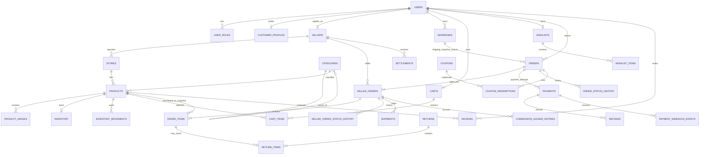

# MarketHub - Phase 3: Database Design

**Status:** Initial relational design  
**Database:** MySQL  
**Migration approach:** Versioned SQL migrations (Flyway)

## 1. Data design principles

- Store marketplace facts in normalized relational tables and enforce ownership with foreign keys and service authorization.
- Store money as `DECIMAL`, never floating point; keep one configured marketplace currency for the first release.
- Snapshot the purchased product name, SKU, and unit price on each order item so later catalog edits do not rewrite history.
- Keep stock movements, order status changes, payment events, returns, and refunds auditable.
- Use soft deactivation for categories, products, and sellers where historical records must remain readable.
- Use unique provider event/reference constraints to support idempotent processing.
- Use UTC timestamps and explicit `created_at` / `updated_at` fields for mutable records.

## 2. Core entity relationship diagram

The diagram emphasizes the commerce and ownership relationships. Supporting columns and constraints follow below; the first migrations may be split by bounded module rather than created as one enormous script.

## 3. Entity and table responsibilities

### Identity and ownership

| Table | Important fields and constraints |
|---|---|
| `users` | `id`, unique normalized `email`, `password_hash`, `display_name`, `status`, timestamps. Password hash only. |
| `roles` | Fixed role codes such as `CUSTOMER`, `SELLER`, `ADMIN`; role assignment is controlled by backend/admin workflow. |
| `user_roles` | Composite unique (`user_id`, `role_id`); foreign keys to users and roles. |
| `refresh_tokens` | User, token hash, family/rotation metadata, expiry, revoked time. Unique token hash; never store raw token. |
| `customer_profiles` | One-to-one user profile fields. |
| `addresses` | User-owned delivery/contact details; use inactive/deleted marker rather than editing past order snapshots. |
| `sellers` | One-to-one applicant user, legal/store data, approval status, reviewer and reviewed timestamp. |
| `stores` | Seller-owned public store name, slug, description, status; unique slug. |

### Catalog and inventory

| Table | Important fields and constraints |
|---|---|
| `categories` | Optional `parent_id`, unique slug, name, active flag; indexed parent and active state. |
| `products` | Seller/store, category, SKU, name, description, brand, price, status, dimensions/weight fields, timestamps. Unique (`store_id`, `sku`). |
| `product_images` | Product, storage key/URL, alt text, sort order. Store references rather than image bytes. |
| `product_variants` | Optional MVP extension for option combinations; unique seller SKU and product/variant key. Add only when product flow needs variants. |
| `inventory` | One row per stock-managed SKU with `on_hand`, `reserved`, version, updated time; check `on_hand >= 0`, `reserved >= 0`, and `reserved <= on_hand`. |
| `inventory_movements` | SKU, quantity delta, reason, reference type/id, actor, timestamp; append-only audit. |
| `inventory_reservations` | Checkout/order item reference, quantity, state, expiry; unique active reservation key per order item. |

### Cart and promotions

| Table | Important fields and constraints |
|---|---|
| `carts` | One active cart per user; unique `user_id`. |
| `cart_items` | Cart, product/variant, quantity; unique cart/SKU. Price is not authoritative here. |
| `wishlists`, `wishlist_items` | One wishlist per user, unique user; unique wishlist/product. Unavailable products remain displayable as unavailable. |
| `coupons` | Unique case-normalized code, validity interval, discount type/value, limits, active state, applicability rules. |
| `coupon_redemptions` | Coupon, customer, order, amount saved; unique idempotency key and order/coupon/customer as policy requires. |

### Orders, payment, fulfillment

| Table | Important fields and constraints |
|---|---|
| `orders` | Customer, unique public order number, parent state, totals, currency, immutable shipping-address snapshot, placed timestamp. |
| `seller_orders` | Parent order, seller, seller-specific subtotal/discount/shipping/tax/commission/total, state; unique (`order_id`, `seller_id`). |
| `order_items` | Seller order, product reference (nullable if later removed), product name/SKU/variant/price snapshots, quantity, line discount/tax/total, item state. |
| `order_status_history` | Parent order, prior/new state, actor, timestamp, reason. Append-only. |
| `seller_order_status_history` | Seller order, prior/new state, actor, timestamp, reason. Append-only. |
| `payments` | Order, provider, provider payment/order references, amount/currency, state, idempotency key; unique provider references. |
| `payment_webhook_events` | Provider event ID, payload digest/reference, received/processed timestamps, processing result; unique provider/event ID. Do not store sensitive card data. |
| `refunds` | Payment, order or seller-order/item allocation, provider refund reference, amount, currency, state; unique provider refund reference. |
| `shipments` | Seller order, carrier/tracking reference, state and timestamps. Tracking is seller-suborder scoped. |

### Returns, reviews, and seller settlement

| Table | Important fields and constraints |
|---|---|
| `returns` | Customer, status, reason, requested/decided timestamps, decision actor. |
| `return_items` | Return, order item, quantity, resolution; positive quantity not exceeding eligible quantity, enforced in service transaction. |
| `reviews` | Customer, product, order item, rating, text, moderation state; unique order-item/customer review. Purchase eligibility enforced in service. |
| `commission_ledger_entries` | Seller order/item, rate and amount snapshots, state and reversal reference. Append-only accounting entries. |
| `settlements` | Seller, period, currency, gross/commission/refund/net amounts, state, payout reference. |
| `notifications` | User, type, payload reference, read/delivery state, timestamps. Avoid copying sensitive payment data into messages. |
| `audit_logs` | Actor, action, resource type/id, timestamp, request correlation ID; redact credentials and tokens. |

## 4. Order splitting and price snapshots

For a checkout containing items from multiple sellers:

1. Create one `orders` row for the customer and shipping snapshot.
2. Group line items by seller and create one `seller_orders` row for each seller.
3. Create `order_items` under the matching seller order, copying product name, SKU/variant, and calculated unit price into snapshot columns.
4. Allocate order-level discounts, shipping, and tax using documented deterministic rules so the sum of seller order allocations equals the parent total.
5. Create inventory reservation rows and pending payment state within the same database transaction.
6. Store provider requests/results separately. A verified webhook advances payment and order state idempotently.

All monetary totals use `DECIMAL(19,4)` at storage precision, with display rounding performed according to the configured currency. The first market may display two decimal places; no binary floating-point arithmetic is used.

## 5. Inventory concurrency and idempotency

- Checkout loads inventory rows in sorted SKU order and locks rows with `SELECT ... FOR UPDATE`, or uses a conditional atomic update with affected-row validation.
- Reservation reduces sellable availability without immediately losing the audit trail; a successful payment converts the reservation into a committed stock deduction.
- A reservation release is idempotent and records a movement; repeated timeout/webhook processing cannot release stock twice.
- `inventory_movements`, webhook events, payment provider references, refunds, and settlement ledger references have unique keys where replay protection is required.
- Do not use a cached product or stock value as the final checkout authority.

## 6. Index and constraint baseline

Required early indexes:

- `users(email)` unique.
- `user_roles(user_id, role_id)` unique and `user_roles(role_id, user_id)` for role lookup.
- `sellers(status, created_at)` for approval queue.
- `products(status, category_id, created_at)`, `products(store_id, status)`, and `products(name)` for initial listing/search paths.
- `inventory(product_id)` unique and `inventory_reservations(status, expires_at)` for expiry jobs.
- `cart_items(cart_id)`; `wishlist_items(wishlist_id)` unique with product.
- `orders(customer_id, created_at)`, `orders(public_order_number)` unique.
- `seller_orders(seller_id, status, created_at)` and `seller_orders(order_id, seller_id)` unique.
- `order_items(seller_order_id)`; `payments(order_id, status)`; unique provider event ID.
- `reviews(product_id, moderation_status, created_at)` and unique purchase eligibility key.

Search by product name may initially use MySQL full-text indexes or bounded `LIKE` behavior based on dataset size. A dedicated search service is deferred.

## 7. Migration and data lifecycle

- Use Flyway versioned migrations in `backend/src/main/resources/db/migration`.
- Never rely on Hibernate schema auto-update outside throwaway local experiments; use `validate` in application configuration.
- Migrations are append-only after sharing. Schema changes are forward migrations with explicit data migration where necessary.
- Foreign keys use restrictive delete behavior for order/financial history. Catalog and user lifecycle uses deactivation/anonymization policies rather than cascading deletes into orders.
- Seed development fixtures through an explicit development-only mechanism; never seed shared admin passwords in production.

## 8. Phase 3 acceptance review

- Every core entity has an owner, relationship, and lifecycle purpose.
- Parent order and seller suborder structure supports unified customer history and independent seller fulfillment.
- Order snapshots preserve the purchased facts; inventory/payment/refund actions are auditable and replay-safe.
- Monetary precision, constraints, foreign keys, and lookup indexes are defined.
- The migration approach is explicit and schema creation is not delegated to production Hibernate auto-update.

**Review result:** The relational design covers the MVP and the planned seller-specific commerce workflows. Product variant details and promotion allocation rules will be finalized before their implementation phase.
